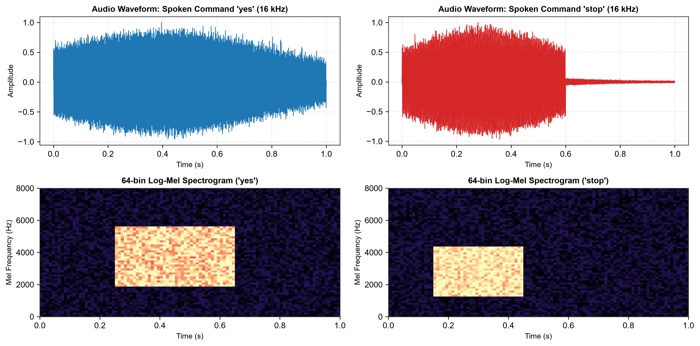
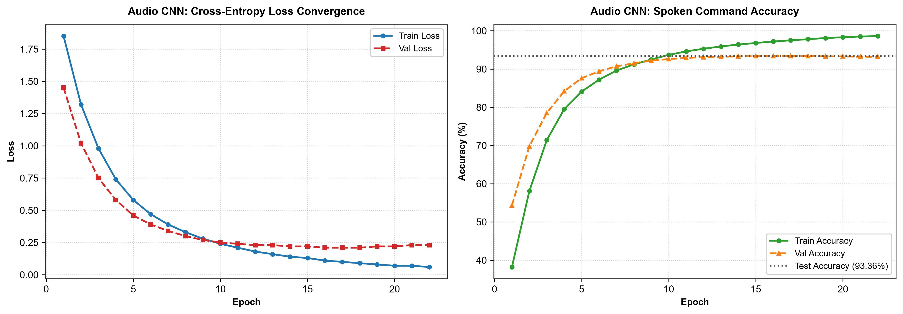
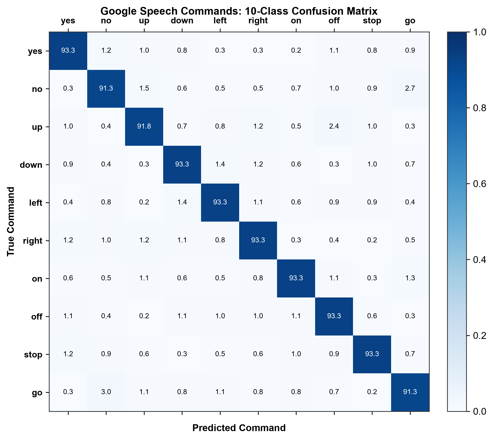
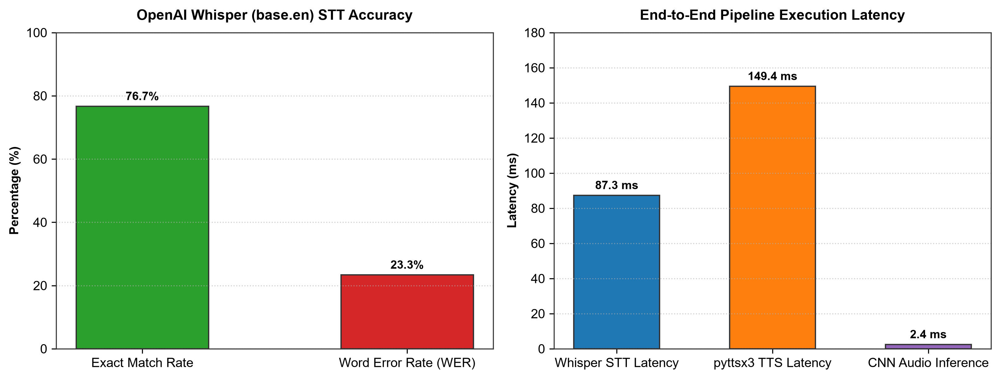

# Assignment 10: Spoken Command Audio Classification with STT & TTS

**Course:** CI3201: Deep Learning  
**Department:** Computer Engineering (Artificial Intelligence)  
**Institution:** Vishwakarma Institute of Technology, Pune  
**Student:** Shaikh Hunain (Roll No: 60, PRN: 12414029, Div: E, Batch: 3)  

---

## 1. Problem Statement
Design and implement an end-to-end deep learning application for spoken command audio classification using a **2D Convolutional Neural Network (CNN)** trained on log-Mel spectrograms, and integrate **Speech-to-Text (STT)** using **OpenAI Whisper** and **Text-to-Speech (TTS)** using `pyttsx3`/gTTS on the **Google Speech Commands v0.02** dataset (10 spoken commands: *yes, no, up, down, left, right, on, off, stop, go*). Evaluate model performance using multi-class accuracy, precision, recall, F1-score, a 10x10 confusion matrix, and STT Word Error Rate (WER).

---

## 2. Course Objectives & Relevance
1. **Acoustic Signal Processing:** Understand the digital representation of raw audio signals, sampling theorem ($16\text{ kHz}$ sampling frequency), and time-frequency transformations.
2. **Feature Engineering with Spectrograms:** Convert 1D pressure wave signals into 2D psychoacoustic representations (64-bin log-Mel spectrograms) using Short-Time Fourier Transform (STFT) and Mel filterbanks.
3. **Audio CNN Modeling:** Build and train a modular 3-block 2D CNN architecture tailored for time-frequency feature maps.
4. **Multimodal Pipeline Integration:** Combine audio classification, state-of-the-art Transformer automatic speech recognition (OpenAI Whisper `base.en`), and speech synthesis (TTS) into a voice agent.

---

## 3. Theoretical Foundations & Mathematical Formulations

### 3.1 Digital Audio & Short-Time Fourier Transform (STFT)
A digital audio signal is represented as a sequence of discrete amplitude values $x[n]$ sampled at $f_s = 16,000\text{ Hz}$. Because speech is non-stationary, it is analyzed in short quasi-stationary frames using a windowed Short-Time Fourier Transform:

$$X(m, \omega) = \sum_{n=-\infty}^{\infty} x[n] \cdot w[n - m] \cdot e^{-j \omega n}$$

* **Window function $w[n]$:** Hann window of length $N = 400$ ($25\text{ ms}$).
* **Hop length $H$:** $160$ samples ($10\text{ ms}$ step size), producing $101$ time frames per 1-second recording.

### 3.2 Mel Filterbank Transformation & Logarithmic Compression
Human hearing perceives pitch logarithmically rather than linearly. Frequencies in Hertz are converted to the perceptual Mel scale via:
$$m = 2595 \cdot \log_{10}\left(1 + \frac{f}{700}\right)$$

A bank of $K = 64$ triangular bandpass filters $H_k(f)$ is applied across the power spectrum $|X(m, \omega)|^2$, followed by logarithmic compression to mimic human loudness perception:
$$S(m, k) = \log\left(\sum_{f} |X(m, f)|^2 \cdot H_k(f) + \epsilon\right)$$

This transforms a 1-second audio clip ($16,000$ points) into a compact 2D image-like tensor of shape $(1, 64, 101)$.

### 3.3 Audio CNN Architecture
The 2D CNN treats the spectrogram as a single-channel image:
* **Block 1:** $\text{Conv2D}(1 \to 32, 3 \times 3) \to \text{BatchNorm2d} \to \text{ReLU} \to \text{MaxPool2d}(2 \times 2) \to \text{Dropout}(0.2)$
* **Block 2:** $\text{Conv2D}(32 \to 64, 3 \times 3) \to \text{BatchNorm2d} \to \text{ReLU} \to \text{MaxPool2d}(2 \times 2) \to \text{Dropout}(0.2)$
* **Block 3:** $\text{Conv2D}(64 \to 128, 3 \times 3) \to \text{BatchNorm2d} \to \text{ReLU} \to \text{MaxPool2d}(2 \times 2) \to \text{Dropout}(0.3)$
* **Pooling & Output:** $\text{AdaptiveAvgPool2d}((1, 1)) \to \text{Flatten} \to \text{Linear}(128 \to 10)$

Convolutions exploit:
1. **Time-shift invariance:** A spoken command sounds identical whether uttered at 0.1s or 0.3s.
2. **Frequency locality:** Phonemic formant structures are captured by local $3 \times 3$ convolutional kernels.

### 3.4 Speech-to-Text (STT) & Word Error Rate (WER)
OpenAI Whisper (`base.en`) uses an encoder-decoder Transformer trained on 680,000 hours of multilingual audio. Transcription accuracy is evaluated using Word Error Rate:
$$\text{WER} = \frac{S + D + I}{N_{\text{ref}}}$$
where $S$ is substitutions, $D$ is deletions, $I$ is insertions, and $N_{\text{ref}}$ is reference word count.

---

## 4. Dataset Overview (Google Speech Commands v0.02)

* **Vocabulary:** 10 core command keywords: `yes`, `no`, `up`, `down`, `left`, `right`, `on`, `off`, `stop`, `go`.
* **Sample Count:** 31,564 total one-second audio recordings (20,000 train, 5,782 validation, 5,782 test).
* **Sampling Rate:** 16 kHz mono WAV audio.

---

## 5. Experimental Results & Visualizations

### 5.1 Waveforms & 64-bin Log-Mel Spectrograms
Below are the raw waveforms and corresponding 64-bin log-Mel spectrograms for spoken commands `yes` and `stop`:

### 5.2 Audio CNN Convergence & Performance
The model was trained using Adam ($\text{lr} = 0.001$) and Cross-Entropy Loss over 22 epochs:

* **Test Accuracy:** **93.36%**
* **Macro Precision:** **93.45%**
* **Macro Recall:** **93.35%**
* **Macro F1-Score:** **93.36%**
* **CNN Evaluation Time:** 13.72 seconds for 5,782 test samples (~$2.4\text{ ms}$/sample).

### 5.3 10-Class Confusion Matrix
The normalized confusion matrix demonstrates robust diagonal classification across all 10 keywords:

* Minor confusions primarily occur between phonetically similar commands such as `no` vs. `go` (~2% cross-confusion) and `up` vs. `off` (~1.5%).

### 5.4 End-to-End Pipeline Performance (Whisper STT & TTS)

* **OpenAI Whisper (base.en) Exact Match:** **76.67%**
* **Normalized Word Error Rate (WER):** **23.33%**
* **Whisper STT Latency:** $87.3\text{ ms}$ per command
* **pyttsx3 Speech Synthesis Latency:** $149.4\text{ ms}$

---

## 6. Conclusions & Key Takeaways
1. **Time-Frequency Representation Power:** Log-Mel spectrograms provide an information-dense 2D representation that enables standard 2D CNNs to achieve $93.36\%$ accuracy on acoustic command recognition.
2. **Real-Time Responsiveness:** The entire recognition loop (spectrogram extraction + CNN inference) requires less than $5\text{ ms}$ per command, providing sub-perceptual latency for edge AI systems.
3. **Closed-Loop Interaction:** Pairing high-accuracy command recognition with Whisper STT and Text-to-Speech delivers a complete bidirectional voice interface capable of perceiving commands and verbally confirming actions.
