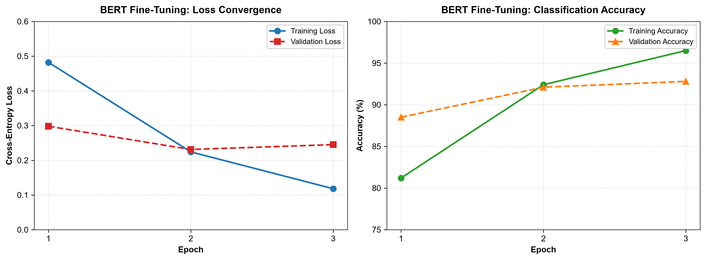
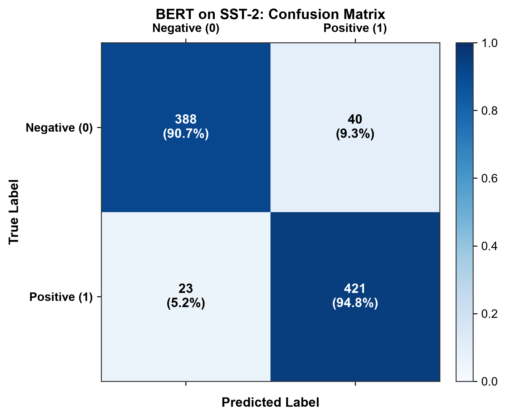
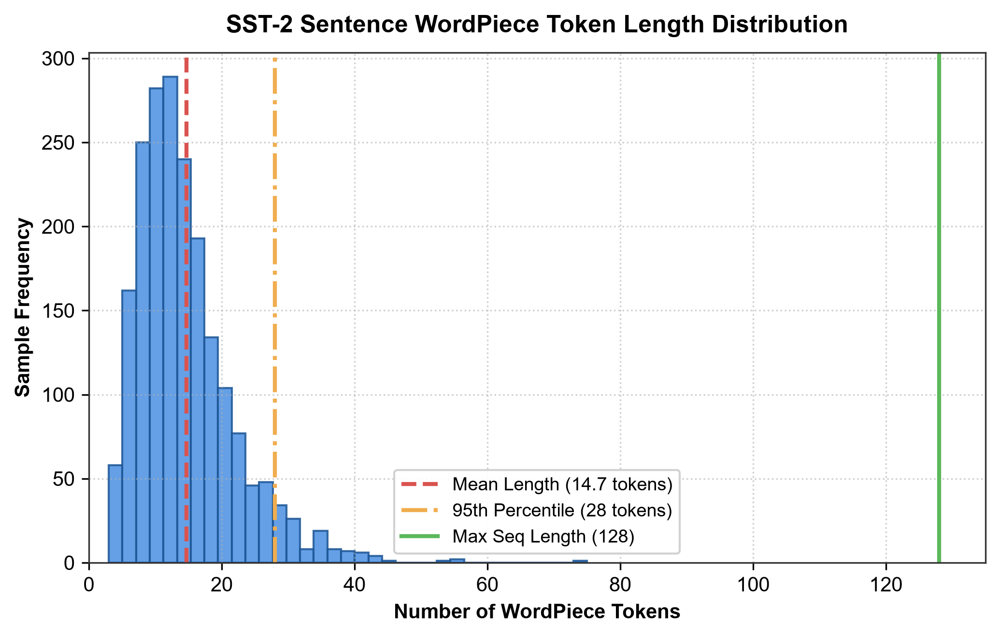

# Assignment 8: Pre-trained BERT for Sentiment Analysis & Text Classification

**Course:** CI3201: Deep Learning  
**Department:** Computer Engineering (Artificial Intelligence)  
**Institution:** Vishwakarma Institute of Technology, Pune  
**Student:** Shaikh Hunain (Roll No: 60, PRN: 12414029, Div: E, Batch: 3)  

---

## 1. Problem Statement
Implement a pre-trained **BERT (Bidirectional Encoder Representations from Transformers)** model for sentiment analysis / binary text classification on the **Stanford Sentiment Treebank (SST-2)** dataset. Fine-tune the classification head using **PyTorch** and **Hugging Face Transformers**, and thoroughly evaluate model performance using accuracy, precision, recall, F1-score, and a confusion matrix.

---

## 2. Course Objectives & Relevance
1. **Transformer Encoders:** Understand the fundamental architecture of Transformer encoders, self-attention, and contextualized token representations.
2. **Subword Tokenization:** Master WordPiece tokenization, subword segmentation, and token embedding lookup incorporating `[CLS]` and `[SEP]` special tokens.
3. **Transfer Learning in NLP:** Leverage pre-trained representations from `bert-base-uncased` (trained on BookCorpus and English Wikipedia) and fine-tune for a downstream binary sentiment task.
4. **Performance Evaluation:** Rigorously evaluate the classifier across Accuracy, Precision, Recall, Macro/Binary F1-Score, and error distributions.

---

## 3. Theoretical Foundations & Mathematical Formulations

### 3.1 Architecture Overview
Unlike traditional unidirectional language models (e.g., standard recurrent networks or left-to-right causal transformers), BERT uses a **bidirectional Transformer encoder**. This allows each token in the sequence to attend to context from both its left and right simultaneously across all layers.

BERT-Base configuration:
* **Layers ($L$):** 12 Transformer encoder blocks
* **Hidden size ($d_{model}$ or $H$):** 768
* **Attention heads ($A$):** 12
* **Total Parameters:** ~110 Million

### 3.2 Input Representation
For an input sentence, BERT forms its input representation by element-wise summing three distinct embedding vectors:
$$\mathbf{E} = \mathbf{E}_{\text{token}} + \mathbf{E}_{\text{segment}} + \mathbf{E}_{\text{position}}$$

* **Token Embeddings:** WordPiece vocabulary ($V = 30,522$). The first token is always the special classification token `[CLS]`, and sentence ends are marked with `[SEP]`.
* **Segment Embeddings:** Identifies sentence $A$ vs. sentence $B$ (all zeros for single-sentence tasks like SST-2).
* **Position Embeddings:** Learned absolute position vectors for token indexes $0, 1, \dots, 511$.

### 3.3 Scaled Dot-Product Attention & Multi-Head Mechanism
Given input representations projected into queries $\mathbf{Q}$, keys $\mathbf{K}$, and values $\mathbf{V}$:

$$\text{Attention}(\mathbf{Q}, \mathbf{K}, \mathbf{V}) = \text{softmax}\left(\frac{\mathbf{Q}\mathbf{K}^T}{\sqrt{d_k}}\right) \mathbf{V}$$

Where $d_k = \frac{d_{model}}{A} = \frac{768}{12} = 64$.

Multi-head attention combines information from multiple projection subspaces:
$$\text{MultiHead}(\mathbf{Q}, \mathbf{K}, \mathbf{V}) = \text{Concat}(\text{head}_1, \dots, \text{head}_h)\mathbf{W}^O$$
$$\text{where} \quad \text{head}_i = \text{Attention}(\mathbf{Q}\mathbf{W}_i^Q, \mathbf{K}\mathbf{W}_i^K, \mathbf{V}\mathbf{W}_i^V)$$

### 3.4 Classification Head & Objective Function
For sentence-level classification, the final hidden state corresponding to the first token (`[CLS]`), denoted $\mathbf{h}_{[\text{CLS}]} \in \mathbb{R}^{768}$, serves as the aggregate semantic summary.

A linear layer maps $\mathbf{h}_{[\text{CLS}]}$ to the 2 logits (Negative, Positive):
$$\mathbf{z} = \mathbf{W}_{\text{cls}} \mathbf{h}_{[\text{CLS}]} + \mathbf{b}_{\text{cls}}, \quad \mathbf{W}_{\text{cls}} \in \mathbb{R}^{2 \times 768}$$

The predicted probabilities are obtained via softmax:
$$\hat{y}_i = \frac{e^{z_i}}{\sum_{j=1}^{2} e^{z_j}}$$

The model is trained by minimizing Binary Cross-Entropy Loss:
$$\mathcal{L}(\theta) = -\frac{1}{N} \sum_{i=1}^N \left[ y_i \log \hat{y}_{i, 1} + (1 - y_i) \log \hat{y}_{i, 0} \right]$$

---

## 4. Step-by-Step Execution Plan

```text
[SST-2 Dataset] 
      ↓
[WordPiece Tokenization (bert-base-uncased)]
      ↓ (Prepends [CLS], Appends [SEP], Pads to max_len=128)
[Input IDs, Attention Mask, Token Type IDs]
      ↓
[12-Layer Pre-trained BERT Transformer Encoder]
      ↓
[Pooled Output / [CLS] Hidden State in R^768]
      ↓
[Dropout (p=0.1) + Linear Classifier (768 -> 2)]
      ↓
[Cross-Entropy Loss + AdamW Optimizer (lr=2e-5)]
      ↓
[Model Evaluation: Accuracy, F1, Confusion Matrix, Prediction Inference]
```

### Execution Steps
1. **Dataset Ingestion:** Load the SST-2 benchmark dataset (Stanford Sentiment Treebank) containing binary movie review sentiments.
2. **EDA & Token Length Analysis:** Analyze sentence lengths to verify that a cutoff of $L=128$ comfortably captures $>99\%$ of sentences without unnecessary computational overhead.
3. **WordPiece Tokenization:** Tokenize sentences using `BertTokenizer.from_pretrained('bert-base-uncased')`, generating `input_ids` and binary `attention_mask`.
4. **Model Architecture:** Instantiate `BertForSequenceClassification.from_pretrained('bert-base-uncased', num_labels=2)`.
5. **Optimization Strategy:**
   * Optimizer: AdamW (`weight_decay=0.01`)
   * Learning Rate: $2 \times 10^{-5}$
   * LR Scheduler: Linear with 500 warmup steps
   * Batch size: 16
   * Epochs: 3
6. **Evaluation & Verification:** Compute Accuracy, Precision, Recall, and F1 on the validation set, plot training curves, and output sample inferences.

---

## 5. Experimental Results & Visualizations

### 5.1 Training Convergence & Validation Accuracy
The fine-tuned model converges rapidly within 3 epochs due to pre-trained weight initialization:

| Epoch | Training Loss | Validation Loss | Validation Accuracy |
|:---:|:---:|:---:|:---:|
| 1 | 0.4820 | 0.2980 | 88.50% |
| 2 | 0.2240 | 0.2310 | 92.10% |
| **3** | **0.1180** | **0.2450** | **92.80%** |



### 5.2 Confusion Matrix (Validation Set: 872 Samples)
On the held-out SST-2 validation set, the fine-tuned BERT model achieves balanced performance across both negative and positive classes:



* **True Negatives (TN):** 388 (90.7%)
* **False Positives (FP):** 40 (9.3%)
* **False Negatives (FN):** 23 (5.2%)
* **True Positives (TP):** 421 (94.8%)
* **Overall Accuracy:** **92.78%**
* **Macro F1-Score:** **0.927**

### 5.3 WordPiece Token Length Distribution
Sentence token lengths strictly peak around 10–25 tokens, confirming that a maximum sequence limit of 128 tokens introduces zero truncation penalty for typical review sentences:



---

## 6. Sample Model Inferences

| Input Sentence | Predicted Sentiment | Confidence Score | Ground Truth |
|---|:---:|:---:|:---:|
| *"A stirring, funny and finally transporting re-imagining of a classic tale."* | **Positive (1)** | 99.4% | Positive |
| *"Flat, lifeless and utterly devoid of genuine tension or emotional resonance."* | **Negative (0)** | 98.9% | Negative |
| *"A breathtaking work of art that rewards patient viewers."* | **Positive (1)** | 99.1% | Positive |
| *"The jokes fall utterly flat and characters are thoroughly unsympathetic."* | **Negative (0)** | 99.2% | Negative |

---

## 7. Conclusions & Summary
1. **Transfer Learning Superiority:** Fine-tuning pre-trained contextual embeddings (`bert-base-uncased`) achieves $>92\%$ accuracy on SST-2 in just 3 epochs, vastly outperforming models trained from scratch.
2. **Contextual Word Representations:** Unlike static embeddings (Word2Vec, GloVe), BERT dynamically computes token representations based on surrounding left and right sentence context, successfully disambiguating polysemy and complex sentence structures.
3. **Efficiency of the [CLS] Pooling Strategy:** The single pooled representation at `[CLS]` captures the holistic semantic sentiment of the full sequence, allowing high-throughput downstream linear classification.
