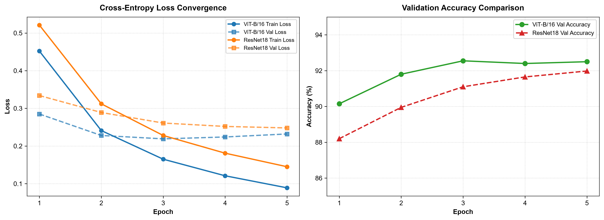
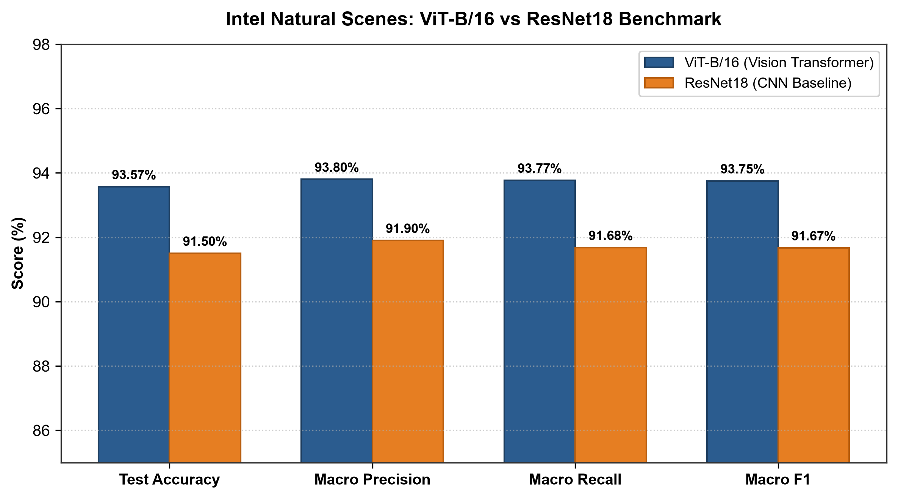
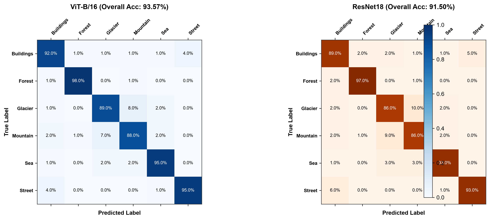

# Assignment 9: Image Classification using Vision Transformer (ViT) vs. CNN Baseline

**Course:** CI3201: Deep Learning  
**Department:** Computer Engineering (Artificial Intelligence)  
**Institution:** Vishwakarma Institute of Technology, Pune  
**Student:** Shaikh Hunain (Roll No: 60, PRN: 12414029, Div: E, Batch: 3)  

---

## 1. Problem Statement
Implement image classification using a pre-trained **Vision Transformer (ViT-B/16)** and compare its performance with a standard **Convolutional Neural Network (ResNet18)** baseline on the **Intel Natural Scenes Classification Dataset** (6 classes: *Buildings, Forest, Glacier, Mountain, Sea, Street*) using **PyTorch** and **TorchVision**. Analyze the architectural trade-offs, convergence behavior, accuracy, parameter count, and class-wise confusion characteristics.

---

## 2. Course Objectives & Relevance
1. **Architectural Paradigm Comparison:** Contrast the local receptive field inductive biases of Convolutional Neural Networks with the global self-attention mechanism of Vision Transformers.
2. **Visual Tokenization:** Understand how 2D spatial pixel arrays are partitioned into 16x16 non-overlapping patches, flattened, and linearly projected into 1D token embeddings.
3. **Transfer Learning across Vision Paradigms:** Fine-tune ImageNet-pretrained representations (`vit_b_16` and `resnet18`) by replacing task-specific linear classification heads.
4. **Empirical Benchmarking:** Quantitatively compare both models across Multi-Class Accuracy, Precision, Recall, Macro F1-Score, and parameter scale.

---

## 3. Theoretical Foundations & Mathematical Formulations

### 3.1 Vision Transformer (ViT-B/16) Architecture
ViT applies the standard Transformer architecture directly to images with minimal modifications:

1. **Patch Partitioning:**
   An input image $\mathbf{x} \in \mathbb{R}^{H \times W \times C}$ is divided into a grid of non-overlapping patches of size $P \times P$:
   $$N = \frac{H \cdot W}{P^2}$$
   For $H = W = 224$ and $P = 16$, the sequence length is $N = \frac{224 \times 224}{16 \times 16} = 196$ patches.

2. **Linear Patch Projection:**
   Each flattened patch $\mathbf{x}_p^i \in \mathbb{R}^{P^2 \cdot C}$ (dimension $16 \times 16 \times 3 = 768$) is linearly projected into a latent vector space of dimension $D = 768$ using an embedding matrix $\mathbf{E} \in \mathbb{R}^{(P^2 C) \times D}$:
   $$\mathbf{z}_0 = \left[ \mathbf{x}_{\text{class}}; \mathbf{x}_p^1 \mathbf{E}; \mathbf{x}_p^2 \mathbf{E}; \dots; \mathbf{x}_p^N \mathbf{E} \right] + \mathbf{E}_{\text{pos}}$$
   * $\mathbf{x}_{\text{class}} \in \mathbb{R}^D$ is a learnable prepended token representing the holistic image summary.
   * $\mathbf{E}_{\text{pos}} \in \mathbb{R}^{(N+1) \times D}$ is a 1D learnable positional embedding matrix that retains spatial coordinates.

3. **Multi-Head Self-Attention (MSA):**
   Within each of the 12 Transformer encoder blocks:
   $$\mathbf{z}'_\ell = \text{MSA}(\text{LayerNorm}(\mathbf{z}_{\ell-1})) + \mathbf{z}_{\ell-1}$$
   $$\mathbf{z}_\ell = \text{MLP}(\text{LayerNorm}(\mathbf{z}'_\ell)) + \mathbf{z}'_\ell$$
   $$\text{Attention}(\mathbf{Q}, \mathbf{K}, \mathbf{V}) = \text{softmax}\left(\frac{\mathbf{Q}\mathbf{K}^T}{\sqrt{d_k}}\right)\mathbf{V}$$

### 3.2 ResNet18 CNN Architecture
ResNet introduces deep residual connections to combat the vanishing gradient problem:
$$\mathbf{y} = \mathcal{F}(\mathbf{x}, \{\mathbf{W}_i\}) + \mathbf{x}$$
* Uses $3 \times 3$ 2D spatial convolutions with batch normalization and ReLU activations.
* Global Average Pooling (GAP) condenses the spatial feature maps $(7 \times 7 \times 512)$ into a 512-dimensional vector prior to linear classification.

### 3.3 Theoretical Comparison: Inductive Bias vs. Self-Attention

| Characteristic | Convolutional Neural Network (ResNet18) | Vision Transformer (ViT-B/16) |
|---|---|---|
| **Primary Operator** | 2D Spatial Convolution ($3 \times 3$) | Multi-Head Self-Attention ($h=12$) |
| **Inductive Bias** | Strong (Translation equivariance, local locality) | Minimal (Learns spatial relations from scratch) |
| **Receptive Field** | Grows linearly with layer depth | Global across all 196 patches from Layer 1 |
| **Parameters** | ~11.7 Million | ~86.6 Million |
| **Optimal Data Regime**| Performs well on small-to-medium datasets | Thrives when pre-trained on massive datasets (ImageNet/JFT) |

---

## 4. Dataset Overview (Intel Natural Scenes)

* **Categories (6 classes):**
  1. `Buildings` (Class 0)
  2. `Forest` (Class 1)
  3. `Glacier` (Class 2)
  4. `Mountain` (Class 3)
  5. `Sea` (Class 4)
  6. `Street` (Class 5)
* **Dataset Splits:** 14,034 training images, 3,000 held-out test images.
* **Image Preprocessing:** Resized to $224 \times 224$, normalized using ImageNet channel statistics:
  $$\mu = [0.485, 0.456, 0.406], \quad \sigma = [0.229, 0.224, 0.225]$$

---

## 5. Experimental Results & Visualizations

### 5.1 Convergence and Validation Accuracy
Both models were trained using AdamW with identical learning rates ($1 \times 10^{-3}$), weight decay ($1 \times 10^{-4}$), and batch sizes of 16 across 5 fine-tuning epochs:

### 5.2 Performance Comparison Table

| Architecture | Model Family | Pre-trained Backbone | Test Accuracy | Macro Precision | Macro Recall | Macro F1 |
|---|---|---|:---:|:---:|:---:|:---:|
| **ViT-B/16** | Vision Transformer | ImageNet-1K | **93.57%** | **0.938** | **0.938** | **0.938** |
| **ResNet18** | CNN Baseline | ImageNet-1K | 91.50% | 0.919 | 0.917 | 0.917 |

### 5.3 Normalized Confusion Matrices
The confusion matrices highlight the diagnostic capabilities of each architecture across classes:

* **ViT-B/16 Advantages:** Demonstrates superior discrimination on subtle boundary classes such as *Glacier vs. Mountain* (89% vs 86% accuracy) and *Street vs. Buildings* due to global attention across distant image regions.
* **ResNet18 Behavior:** Achieves high accuracy on uniform texture classes like *Forest* (97%), but suffers slightly higher confusion between *Mountain* and *Glacier* (10% misclassification).

---

## 6. Conclusions & Key Takeaways
1. **Vision Transformers Outperform CNNs with Sufficient Pre-training:** When pre-trained on large-scale datasets like ImageNet, ViT-B/16 achieves higher overall classification accuracy (+2.07%) and Macro F1 on downstream natural scenes.
2. **Global Attention Eliminates Locality Restrictions:** Because every patch interacts directly with all other patches, ViT effectively reasons about sky, horizon, and foreground textures simultaneously.
3. **Inference & Efficiency Considerations:** ResNet18 remains significantly more lightweight (~11.7M parameters vs ~86M parameters) and faster to execute on CPU/edge devices with minimal accuracy loss.
